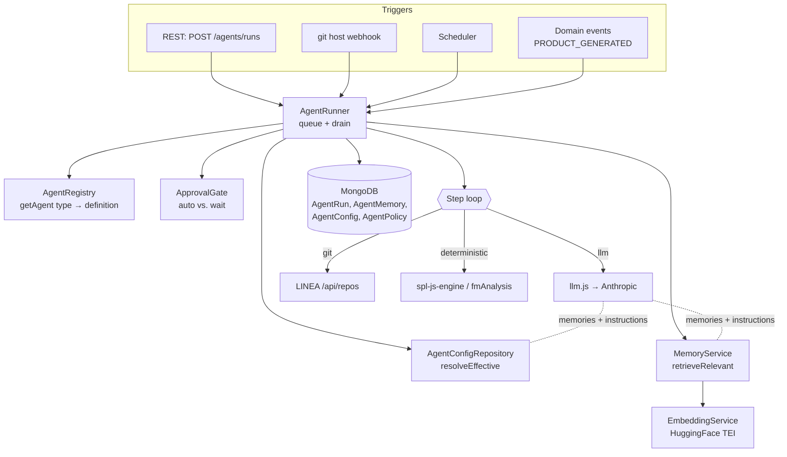
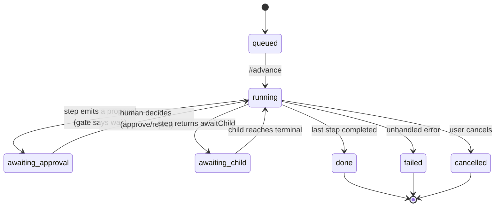
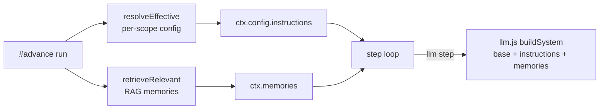
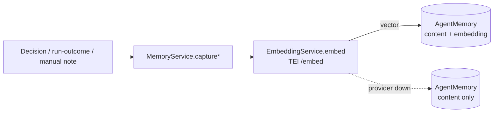
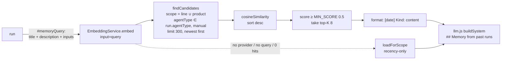
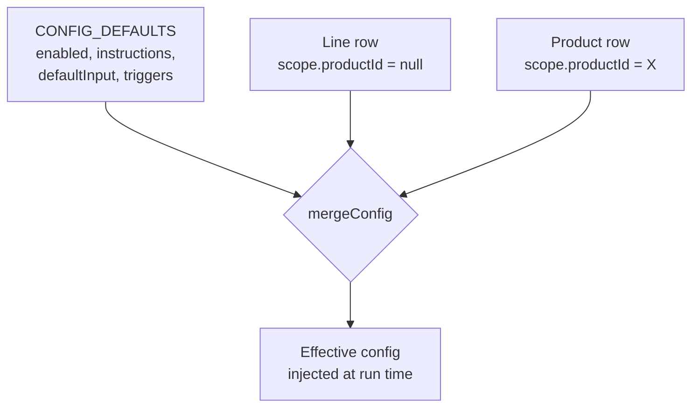

# Agent Architecture

This document gives the architectural view of the agent subsystem: how a run executes,
how the RAG memory pipeline captures and retrieves knowledge, and how per-scope
customization is resolved. For the per-agent reference (steps, triggers, outputs) see
[agents.md](agents.md); for the research grounding see
[research-gaps-and-agents.md](research-gaps-and-agents.md).

All agents run **in-process** on the Node server — there is no separate agent worker.
A single `AgentRunner` (`server/src/agents/core/AgentRunner.js`) owns an in-memory queue
and drains it sequentially, persisting every step to MongoDB so runs survive restarts.

---

## 1. Component overview

---

## 2. Run lifecycle

A run is a row in `AgentRun` with a `cursor` into its definition's step list. The runner
re-enters `#advance` until the run reaches a terminal state; pauses (approval gates, awaited
children) freeze the cursor so the run resumes exactly where it left off.

Per **advancement** (one pass of `#advance`), before the step loop runs, the runner resolves
two cross-cutting inputs once and shares them with every LLM step:

Both lookups are **best-effort**: a config or memory failure logs and falls back to
permissive defaults / recency, never blocking the run.

---

## 3. RAG memory pipeline

Memory is retrieval-augmented: the runner injects the memories most *relevant* to the
current run, not merely the most recent. The pipeline has two halves — capture (write +
embed) and retrieval (embed query → rank → inject).

### Capture

### Retrieval (injected into a run)

Key design points:

- **Scoping.** `findForRun` / `findCandidates` union the line-scoped rows (`productId = null`)
  with the product-scoped rows. Both are filtered to `{ agentType ∈ [run.agentType, 'manual'] }`
  so an agent sees its own history **and** human-authored notes, but not other agents' chatter.
- **Threshold asymmetry.** Run injection applies `MIN_SCORE` (drop noise); the UI recall
  search (`/agents/memory/search`) does **not** — it shows weak matches with their score so
  operators can inspect what the store holds.
- **Graceful degradation.** With no `EMBEDDINGS_URL`, embedding returns `null`, memories are
  stored vector-less, and retrieval falls back to recency — zero regression vs. pre-RAG.
- **Provenance.** `embeddingModel` is stored per row so a model change can be detected and the
  `backfillEmbeddings.js` script can re-embed.

---

## 4. Per-scope customization (config inheritance)

`AgentConfig` rows tune (not define) agents per scope. Resolution is **product over line over
built-in defaults**, computed by the pure `mergeConfig` function so it is unit-testable.

The Customization UI (`AgentCustomizationTab.vue`) needs to show *where* each value comes
from, so `GET /agents/config` returns the raw `lineConfig` and `productConfig` rows alongside
the merged `config` (via `resolveEffectiveWithSource`). At product scope the editor shows an
"Overriding line default" vs. "Inheriting line default" banner; **Reset to line default**
(`DELETE /agents/config`) drops the product row so the agent falls back to the line value.

---

## 5. Key files

| Concern | File |
|---------|------|
| Queue, drain, step loop, lifecycle | `server/src/agents/core/AgentRunner.js` |
| Agent registration | `server/src/agents/core/AgentRegistry.js`, `definitions/index.js` |
| LLM calls + prompt assembly | `server/src/agents/core/llm.js` (`buildSystem`) |
| Memory service (capture + RAG) | `server/src/agents/memory/MemoryService.js` |
| Embeddings + cosine | `server/src/agents/memory/EmbeddingService.js` |
| Memory persistence | `server/src/agents/models/AgentMemory.js`, `AgentMemoryRepository.js` |
| Config persistence + merge | `server/src/agents/models/AgentConfig.js`, `AgentConfigRepository.js` |
| Customization UI | `client/src/features/agents/AgentCustomizationTab.vue`, `AgentList.vue`, `AgentConfigDetail.vue`, `AgentMemoryCard.vue` |
